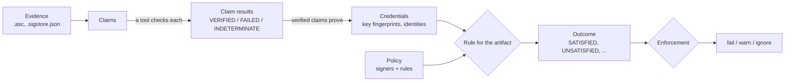

# How Sigmund Works

Sigmund answers one question about every artifact a build uses: **is it from someone you
trust?** A valid signature alone does not answer it — anyone can sign anything. What matters is
*who* signed, and whether that is who you expect for that artifact. This page explains the model
Sigmund uses to answer the question, and how signing feeds it. The other pages explain each part
in detail.

## Verification in one picture

### Evidence and claims

**Evidence** is a file next to the artifact that makes assertions about it: an OpenPGP `.asc`
signature, a Sigstore `.sigstore.json` bundle. Sigmund finds it the way repositories publish it —
as a sidecar of the artifact.

A **claim** is one assertion that can be checked on its own. Most evidence holds one claim; a
hybrid `.asc` with a classic and a post-quantum signature holds two, and each is checked
separately.

### Checking a claim

Each claim goes to a tool that can check it — Bouncy Castle (built in), Sequoia `sq`, GnuPG `gpg`,
or the Sigstore verifier. Whichever tool answers, the answer is the same: the tools are held to
one set of rules and one list of accepted algorithms, so an outcome never depends on what is
installed. A claim ends up:

- **`VERIFIED`** — the signature is valid;
- **`FAILED`** — it must not be trusted: the bytes do not match, or the key had expired or was
  revoked. This is the **attack signal**, and nothing can tolerate it;
- **`INDETERMINATE`** — nothing was established either way, with a reason: the key could not be
  found, the algorithm is not accepted, the tool did not run.

Keeping "could not check" apart from "checked and rejected" is deliberate: a missing key is a
setup problem, not tampering.

A claim no installed tool can read at all — a post-quantum signature with no `sq` installed — is
**set aside** rather than counted against the artifact, so the other claims decide.

### Credentials

A verified claim **proves credentials** — what the signature establishes about who made it.
There are two kinds:

- **Key material** — the full fingerprint of the key that signed (and its primary key). The
  signature itself proves it.
- **An identity** — an email address or a CI workflow, vouched for by an **issuer** you trust:
  the keys.openpgp.org directory, which publishes an address on a key only after its owner
  confirms it, or an OIDC provider such as GitHub Actions, through a Sigstore certificate.

The user ID written inside an OpenPGP key is never a credential: anyone can write any name there.

### The policy: signers and rules

The **policy** in `sigmund.yaml` says what you expect:

- **Signers** name who you trust, by the credentials they prove — key fingerprints, an email
  address, a CI workflow identity.
- **Rules** match artifacts by pattern (`io.quarkus:*`) and say which signers they require. For
  each artifact, the most specific matching rule applies.

You rarely write it by hand: `sigmund:dependency-signers` generates one from the signatures your
dependencies already carry, and updates it when they change.

### Outcomes

Each artifact gets one **outcome** from its claims and its rule:

| Outcome | Meaning |
|---|---|
| `SATISFIED` | The verified claims meet what the rule requires |
| `UNSATISFIED` | Claims verified, but not by the signers the rule requires |
| `FAILED` | A claim failed — the attack signal |
| `NO_CLAIM` | No evidence was found |
| `INDETERMINATE` | Evidence was found but could not be checked |
| `NOT_CONFIGURED` | No rule matches the artifact |

An outcome is a fact about the artifact. It is the same whether or not it stops the build.

### When the answer is INDETERMINATE

`INDETERMINATE` means Sigmund could not tell, so it does not guess: an artifact it cannot judge is
not called `UNSATISFIED`. It happens in two ways.

**A claim could not be checked**, and it might have satisfied the rule. The reason says why:

- `KEY_UNAVAILABLE` — the signing key is in no keyring and could not be fetched, or the copy found
  cannot be used (keys.openpgp.org serves a key without its self-signatures until its owner
  confirms an address). A failed or disabled directory lookup for an email identity lands here
  too. Allow key fetching, or try another keyserver.
- `UNSUPPORTED_ALGORITHM` — no installed tool can check the signature, or it uses an algorithm
  Sigmund does not accept. Installing `sq` checks post-quantum signatures.
- `TOOL_UNAVAILABLE` — a verification tool could not run, or broke while running.
- `TRUST_ROOT_UNAVAILABLE` — Sigstore's trust metadata is missing or too old.
- `EVIDENCE_MALFORMED` — the signature or bundle could not be parsed.

**The rule cannot be judged because claims were set aside.** A co-signer's post-quantum signature
that no installed tool reads is not a wrong signer — it may be exactly the one the rule requires.

Some reasons are transient — a keyserver that was down may answer on the next run. The others
stay until something changes: a tool installed, a key fetched, the evidence fixed. The full list
is in [Outcomes and reasons](verification.md#outcomes-and-reasons).

### Enforcement

**Enforcement** decides what each outcome does: `fail` the build, `warn`, or `ignore`. A rule or
the policy's `defaults` set it per outcome — tolerating unsigned test fixtures, say — except for
`FAILED`, which always fails.

Without a policy, Sigmund **observes**: it verifies and reports everything, and only a `FAILED`
signature blocks. This makes it safe to try on any project. Once the file has `rules`, Sigmund
**enforces**: every outcome other than `SATISFIED` blocks unless the policy relaxes it.

## Signing

Signing produces the evidence that verification reads:

- Each **signing tool** — `bc`, `sq`, `gpg`, `sigstore` — signs with the keys its own settings
  name, or its default key.
- The run may **request credential types** (`pgp4`, `pgp6`, `sigstore`), directly or through a
  named profile; only the keys of those types sign. Asking for a type no key has fails before
  anything is signed.
- All OpenPGP signatures of an artifact land in **one `.asc`**, classic signature first, so tools
  that read only the first block still work; Sigstore writes its own bundle.
- When `signing.signer` names who should be signing, every signature is checked against that
  signer before anything is written — the same check verification will make.

## Where to go next

- [Getting Started](getting-started.md) — see who signed your dependencies, then enforce it
- [Trust Verification](trust-verification.md) — policies, outcomes and generating them
- [Signature Verification](verification.md) — claims, tools, reasons and accepted algorithms
- [Signing](signing.md) — keys, tools, profiles and hybrid signatures
- [Configuration](configuration.md) — every section of `sigmund.yaml`
