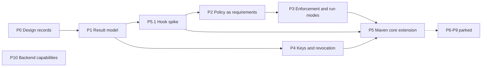

# Sigmund: Verification Roadmap

Status: living document. Updated in the same change that moves a task.

This is the working reference for evolving Sigmund's verification API and
implementation toward the [design direction](sigmund-verification-design-direction.md).
The three documents have distinct jobs:

| Document | Answers | Changes when |
|---|---|---|
| [Design direction](sigmund-verification-design-direction.md) | What and why | The design changes |
| This roadmap | In what order, and where we are | A task starts, finishes, splits, or is added |
| ADRs under [`adr/`](../adr) | What was decided, and the alternatives rejected | A decision is taken |

References such as §3.5 point to sections of the design direction.

---

## Working rules

- **No backward compatibility.** Sigmund has not been adopted. Types, config
  sections, plugin parameters and CLI options are replaced outright — no
  migration code, deprecated aliases or legacy schema readers.
- **Every phase ends in something demonstrable.** A phase is not done until its
  demo runs.
- **Every task ships with tests and docs.** Unit tests for all changes;
  integration tests where a task changes observable plugin or CLI behaviour.
  Affected pages under `docs/` and `AGENTS.md` are updated in the same change.
- **Task IDs are stable.** New tasks are appended to a phase with the next free
  number; tasks are never renumbered. A task that splits keeps its ID with a
  letter suffix (`P1.5a`, `P1.5b`).
- **Decisions go to ADRs, not here.** When a task settles something the design
  direction leaves open, record it as an ADR and link it from the decision log
  below.

Status values: `todo`, `in progress`, `done`, `blocked` (with the blocking
question linked), `dropped` (with a one-line reason), `parked` (kept for later,
not scheduled).

---

## Baseline

Where the code stands against the design direction at the start of this
roadmap. Kept so that task descriptions can be read without re-deriving it.

| Area | Current state | Direction |
|---|---|---|
| Claim vocabulary | `VerificationUnit` sealed over `OpenPgpVerificationUnit`, `SigstoreVerificationUnit` | `Claim` (§3.1) |
| Artifact-level verdict | `TrustVerdict`: `TRUSTED`, `UNTRUSTED`, `UNSIGNED`, `NOT_CONFIGURED`, `VERIFICATION_FAILED` | Six outcomes (§3.5) |
| Tool-level verdict | `Verdict`: `PASS`, `FAIL`, `NO_KEY`, `SKIPPED` | Verified, `FAILED`, `INDETERMINATE` with reason |
| Failure mapping | Malformed Sigstore bundle → `FAIL`; Sigstore infrastructure failure → exception; unsupported OpenPGP algorithm → `SKIPPED`, which makes hybrid `.asc` `UNTRUSTED` under `listed-evidence: all` without `sq` | Attack signal and infrastructure problems never collapse (§3.5, §3.2.1) |
| Result | `TrustResult`: identity, verdict, matched and unmatched evidence | Claim, artifact and run results (§3.2) |
| Subject | `ArtifactIdentity`: namespace, name, version — no classifier, extension or digest | GAV + classifier/extension + digest; purl projection (§3.2, §8) |
| Time | Not extracted | Claim time, verification time, evaluation basis (§3.4) |
| Credentials | `FingerprintCredential` matched by suffix, accepting 64-bit key IDs; `EmailCredential` from self-certified UIDs, matching OpenPGP and Sigstore alike; `SigstoreCredential` with seven fixed fields, an omitted issuer accepting any | `KeyCredential` by exact fingerprint and `IdentityCredential` from a trusted issuer (§3.3, [ADR-006](../adr/006-identity-and-credential-model.md)) |
| Policy | `trust` maps patterns to expected signers; `signature-optional`; `policy.on-untrusted`, `listed-evidence`, `unlisted-evidence` | Requirements as conjunctive clauses of signers; per-outcome, per-scope enforcement (§3.2, §3.3, §3.6) |
| Arguments | `sigmund.onUntrusted` and `sigmund.listedEvidence` override policy | Arguments configure how, never what (§5.3) |
| Config location | Plugin default `${project.basedir}/sigmund.yaml`; `ConfigLoader` checks base dir, then `~/.config/sigmund` | One policy at the reactor root (§5.1) |
| Orchestration | Reporting, enforcement and the `signature-optional` pre-filter live in `VerifyMojo` | In core, shared by every insertion point (§2) |
| Insertion points | `verify` and `dependency-signers` goals, bound to `validate`, resolving project dependencies only | Goal and core extension with identical results (§2) |
| Caching | `KeyFetchCache` in memory per session; no result cache | Persistent key store for offline determinism; result cache optional (§3.7) |
| Revocation | Not handled | Reason-code aware (§3.8) |
| Discovery | Sidecar lookup inside `ArtifactFileResolver` | `ProvenanceSource` SPI (§4) |
| Gradle | Plugin on commit `54f0705`, not on `main` | Gradle backend or metadata interop (§2.2) |

---

## Phases

**Next: the hook spike (P5.1).** The design's central claim is that
verification belongs at resolution time because build tooling executes before
any goal runs. That depends on an extension being able to intercept plugin and
extension resolution, so it is confirmed before more is built on the goal. The
answer is also a concrete question for the Maven maintainers (§9). P4 can run
in parallel with P2 and P3.

P6–P9 are parked (see below): each depends on the extension, on adoption that
does not exist yet, or on a consumer nobody has named.

### P0 — Design records

Settle the decisions everything else is built on.

| ID | Task | Refs | Depends | Status |
|---|---|---|---|---|
| P0.1 | Check `Claim` for ambiguity against sigstore-java and OIDC/JWT types on the classpath; choose `Claim` or `VerifiableClaim` | §3.1 | — | done — no class on the 52-jar compile classpath contains "Claim"; the name is `Claim` |
| P0.2 | ADR: result model — claim, artifact and run levels; roll-up rules; claim-set modes | §3.2, §3.2.1, §3.5 | — | done — [ADR-005](../adr/005-verification-result-model.md) |
| P0.3 | ADR: policy schema — role-scoped requirements, claim-set mode, per-outcome and per-target enforcement (`signature-optional` becomes per-target `NO_CLAIM` enforcement), matched-rule location | §3.2, §3.3, §3.6 | P0.2, P0.4 | done — [ADR-007](../adr/007-policy-schema-and-enforcement.md); revised 2026-09-29 (scope cut) |
| P0.4 | ADR: identity and credential model — key material versus attested identity, trusted issuers, subject expansion, key-material provenance | §3.3, §3.8, §5.3 | P0.2 | done — [ADR-006](../adr/006-identity-and-credential-model.md); revised 2026-09-29 (scope cut) |
| P0.5 | ADR: attestation unit and emission point — module for outbound, session run record for inbound, what terminates the chain, where deploy facts live | §2.1, §6 | P0.2 | done — [ADR-008](../adr/008-attestation-unit-and-emission-point.md) |

### P1 — Vocabulary and result model

Establish the result model while the SPI is not public. Validated against the
two claim shapes already shipping — detached `.asc` and Sigstore bundles.

| ID | Task | Refs | Depends | Status |
|---|---|---|---|---|
| P1.1 | Rename `VerificationUnit` and its permits to the claim vocabulary; `SignatureFormat.parse` returns claims; update `AGENTS.md` and architecture docs | §3.1 | P0.1 | done — 30 files; 570 tests pass |
| P1.2 | Subject: classifier, extension and digest on the artifact identity; algorithm-tagged digest type (SHA-256 required) shared by subject, evidence and policy digests; one-way purl projection; policy matching stays at GAV level | §3.2, §8 | — | done — `DigestSet` and `ArtifactSubject` replace `ArtifactIdentity`; digest wiring from file bytes lands with P1.6 |
| P1.3 | Tool results carry claim outcome and reason: `NO_KEY` → `key-unavailable`, unsupported algorithm → `unsupported-algorithm`, malformed evidence → `evidence-malformed` (Sigstore bundle parse currently `FAIL`), Sigstore trust-root failure → `trust-root-unavailable` (currently thrown) | §3.5 | P1.1 | done — `Verdict` replaced by `ClaimOutcome` + `IndeterminateReason`; `TOOL_UNAVAILABLE` added to the reason set |
| P1.4 | Temporal fields: OpenPGP signature creation time and Sigstore integrated time as claim time, with evaluation basis per claim kind; verification time. Key expiry checked against claim time consistently across BC, `sq` and `gpg` (BC does not check expiry today) | §1.1, §3.4, §3.8 | P1.1 | done — claim time and `ClaimTimeSource` live on the `Claim`; BC checks validity at claim time; verification time lands with the result model in P1.6 |
| P1.5 | Attester identity, trust root and evidence reference (file digest, source fixed to sidecar until P7) on the claim result | §3.2, §4 | P1.1 | done — `EvidenceRef` and `TrustRootRef` added, `SignatureTool.trustRoot()` reports the root per tool, both carried on `EvidenceResult` until P1.6 folds them into `ClaimResult`; attester credentials were already there |
| P1.6 | `ArtifactOutcome` and `IndeterminateReason` types; claim, artifact and run result types replacing `TrustResult`, `TrustVerdict` and `Verdict` | §3.2, §3.5 | P0.2, P1.2–P1.5 | done — `ArtifactOutcome`, `AttesterRole`, `ClaimSetMode`, `ClaimResult`, `ArtifactResult`, `RequirementEvaluator`, `OutcomeRollup`. Deferred to the phases that populate them: `Coverage`/`InsertionPoint`/`EnforcementMode` with P3.6, `PolicyRef` with P4.2, the matched-rule reference with P2.6, cache information with P4.3. `ClaimKind` dropped — the claim kind is the format name, which config already uses |
| P1.7 | `TrustVerifier` derives artifact outcomes by the roll-up rules; claim-set mode replaces `listed-evidence` in the verifier | §3.2.1 | P1.6 | done — `TrustResult`, `TrustVerdict`, `MatchedEvidence` and `EvidenceResult` deleted; providers yield `ClaimResult`s; matching moved to `TrustPolicy.requirements()`; `VerifyMojo` reporting reduced pending P1.8/P1.9 |
| P1.8 | Move reporting, the pass/fail decision and the `signature-optional` pre-filter from `VerifyMojo` into core, behind an API with no build-tool types — repository concepts (coordinates, layout, sidecar conventions) allowed; Maven plugin API, project model and resolver session not | §2, §7 | P1.7 | done — `VerificationReport` in core owns grouping, counts, per-result description and the blocking decision; the `signature-optional` pre-filter is deleted rather than moved, so a tolerated artifact is still verified and a broken signature on it still blocks |
| P1.9 | Result model rendering: human report in core; `VerifyMojo` and CLI `verify-signature` switched to it | §3.2 | P1.8 | done — `ReportVerdict` retired in favour of counts by claim outcome, `summary()` renders them. `DependencySignersMojo` moved to P2.8: it consumes no `ArtifactResult`, grouping by signer profile for bootstrap, and P2.8 rewrites that rendering for the new schema |
| P1.10 | Parsed `ArtifactPattern` replacing raw pattern strings: arity and shape validated once at load, specificity carried by the pattern, classifier-scoped patterns rejected instead of silently matching nothing | §3.2 | — | done — pulled forward from P2.6 |
| P1.11 | Backend agreement interop test: the same claim through BC, `sq` and `gpg` yields the same outcome and reason | §1.1, §3.4, §3.5 | P1.6 | done — found a real defect: BC's ECDSA fallback generated keys with no key flags, which Sequoia rejects as "not signing capable" while GnuPG and BC accept them. Expiry-at-claim-time coverage still outstanding: generating an expired key in a test is awkward |
| P1.12 | API-surface audit of the three backends once integrations settle: every public type, constructor and member in core justified by a caller outside the package, or narrowed. Factories stay the construction path | §2, §7 | P1.9 | done — core went from 83 public types to 74. Narrowed: `CliTool`, `AscCombiner` with `OpenPgpSignaturePacketInfo`, `SignatureEvidenceAdapter`, `ArtifactPatternMatcher`, `KeyValidity`, `DefaultTrustPolicy`, `OutcomeRollup`, and the `BcRunner`/`GpgRunner` classes, whose factories were already package-private. `ArtifactResult.of(subject, rollup, …)` was dropped, since it was the only thing publishing `OutcomeRollup.Result` and `TrustVerifier` can build the record directly. `SqRunner` stays public: the CLI constructs it for keygen and cert export, which the `SignatureTool` SPI does not cover. `OpenPgpSignatureFormat` stays public with no caller outside core, because ADR-002 has third-party OpenPGP tools returning it from `signatureTool.signatureFormat()`. The 19 remaining types with no external caller are record components or return types of public API (`ArtifactSubject`, `ClaimResult`, `AttesterRole`, the config records, `RequirementEvaluator` via `TrustPolicy.requirements()`) or optional-capability SPIs (`SignerIdentityResolver`, `SignerInspection`, `CertExporter`) |
| P1.13 | Single-read `Evidence`: an evidence file is read once and digested from those bytes, then detection, parsing and the recorded reference all work from that read — closing the window where the digest describes different bytes than the claims came from | §3.2, §4 | P1.5 | done |
| P1.14 | Doc sync after P1: user docs describe the outcome and reason vocabulary the code now uses, the report the goal and the CLI now print, and the `signature-optional` config element | §3.2, §3.5 | P1.9, P1.12 | done — `verification.md`, `architecture.md`, `cli-reference.md`, `maven-plugin.md`, `trust-verification.md`, `getting-started.md`, `limitations.md`. The `unsigned:` element had been renamed in the parser but not in the docs, so a documented snippet was silently ignored. The deeper policy-schema rewrites stay with P2.11, and the `dependency-signers` report docs with P2.8 |

**Demo:** `sigmund:verify` over fixtures reporting all six outcomes with
reasons, including a hybrid `.asc` verified by Bouncy Castle alone as
`SATISFIED` with the PQC claim set aside.

### P2 — Policy as requirements

| ID | Task | Refs | Depends | Status |
|---|---|---|---|---|
| P2.1 | Credential model: `KeyCredential` and `IdentityCredential(issuer, attributes)` replacing `FingerprintCredential`, `EmailCredential` and `SigstoreCredential`; sealed `Credential`; key material matched by exact full fingerprint, key IDs and suffix matching rejected at load; one identity credential per verified address; `email` compared case-insensitively; an identity entry names at least one attribute besides the issuer | §3.3 | P1.6 | done — together with P2.2–P2.4. `FingerprintCredential`, `EmailCredential` and `SigstoreCredential` removed. All three OpenPGP backends now prove full fingerprints of the verifying key and its primary: BC from the key ring (resolving the key-ID fallback), gpg from `VALIDSIG` via `--status-fd`, sq by reading the certificate it verified against; `BackendAgreementTest` asserts they prove identical key material. Found on the way: `sigstore:` without `issuer` accepted any OIDC issuer |
| P2.2 | Key-material provenance: every claim records the source that supplied the key; `BcRunner.fetchKey` stops preferring whichever keyserver returns user IDs; a UID becomes an identity only when served by a named directory, queried in its own right whatever the `keyservers` argument says, and only when no key credential already satisfies the clause. First confirm which keys.openpgp.org endpoint resolves a signing-subkey fingerprint to its primary key and verified addresses | §3.8, §5.3 | P1.5, P2.1 | done — `OpenPgpDirectory` with a keys.openpgp.org client (`/vks/v1/by-fingerprint/`, which accepts subkey fingerprints; answers and failures cached per session) and `ClaimIdentityResolver` resolving claim identities in `TrustVerifier`; a failed or disabled lookup is `INDETERMINATE(key-unavailable)`; lookups follow `resolve-signers`. BC claims carry the key's source in their `TrustRootRef`; sq and gpg report their keyring. `fetchKey` keeps preferring a keyserver copy with UIDs, since UIDs are display text only — see ADR-006 |
| P2.3 | Top-level `issuers` list, empty by default, the default issuer set for identity entries that name none: every issuer canonically an `https://` URL, known directories checked first and allowed without the scheme, other `https://` URLs OIDC issuers, anything else an error; what each kind can assert is known from the kind; no profiles, no per-issuer settings | §3.3, §5.3 | P2.1, P2.2 | done — `IssuerKind` classifies by name; the list lives on `TrustPolicy.issuers()` |
| P2.4 | Signer config: `identities` — a list of complete identities, each an optional `issuer` and its attributes — and `email:` as shorthand are identity entries matched against the listed issuers, or against an inline `issuer` trusted for that entry only (need not be listed); an entry none of its issuers can assert is a config error naming the issuer to add; per-signer accepted issuers shown in the report; per-issuer-kind attribute vocabulary as a small enum, the OIDC set being Fulcio's full certificate-extension registry (five supported today), an unknown attribute an error suggesting the nearest known name — today a `sigstore:` entry with no issuer accepts any | §3.3 | P2.3 | done — `identities` replaced the `sigstore:` block and the `{address, issuer}` form of `email:`, and `name:` was dropped as unused; unknown signer keys are errors; `IdentityEntryValidator` checks attributes against the Fulcio registry (`.1.9`–`.1.24`) with nearest-name suggestions. Showing each signer's accepted issuers in the report moved to P3.7 |
| P2.5 | Role derivation and assertion | §3.3 | — | dropped — no roles in policy ([ADR-007](../adr/007-policy-schema-and-enforcement.md)); see P2.15 |
| P2.6 | New policy schema and parser: `rules` with `match` and `requires` (signer ids as conjunctive clauses, `any-of` within a clause), `artifact-sets`, `defaults`, `extra-claims`; replaces `trust`, `signature-optional` and `policy`; strict unknown-key errors, specificity ties, non-GAV patterns, empty `requires` and scalar `requires` rejected, locations recorded for matched-rule provenance. Replaces the deprecated `JsonNode.fields()` calls in `SigmundConfigParser` with `properties()` while the parser is being rewritten | §3.2 | P0.3, P1.10, P2.4 | done — review follow-ups 2026-10-15: ties detected for any shared coordinate, bare words in `match` must be artifact-sets, unknown top-level keys rejected, `version` removed, clause entries type-checked, issuers classified at compile so signing is unaffected |
| P2.7 | Requirement evaluator: conjunctive clauses, disjunctive `any-of`, `extra-claims` governing remaining claims; `TrustPolicy` becomes rule lookup plus evaluator | §3.2, §3.3 | P1.7, P2.6 | done — `Requirement` implements `RequirementEvaluator`; `TrustPolicy.requirements()` and the roll-up's unused `requiredKind` removed |
| P2.8 | `generateTrustConfig` and `updateTrustConfig` emit the new schema — key material, plus an `email:` and the directory in `issuers` for a key the directory served a verified address for; an `identities` entry for a CI workflow identity, which has no email — issuer plus `source-repository-uri` by default, since `subject` and `build-config-uri` carry the release ref, with a comment in the generated file that it accepts any workflow in the repository and naming `build-trigger` and `runner-environment` to tighten it (`SignerInfo.emailIdentity` becomes `identity`, holding either form); one clause per group (`any-of` where several signers were observed), and a tolerant rule (`on-no-claim: ignore`, no `requires`) listing the observed unsigned modules in place of the `signature-optional` list — no catch-all, so a later dependency enters as a reviewed diff ([ADR-007](../adr/007-policy-schema-and-enforcement.md)). Includes `DependencySignersMojo`'s bootstrap report, which groups by signer profile rather than by outcome and is rewritten with the schema it feeds | §5.3 | P2.2, P2.6 | in progress — generate emits `rules` (one requirement rule per group, one tolerant rule listing unsigned modules, no catch-all). `updateTrustConfig` considers artifacts no rule or only a requires-less rule covers, moves newly signed modules out of the tolerant rule, lists signer changes under a requirement for review, reuses existing signers by proven credential, and refuses to write a config that would not load. Directory-verified email emission and workflow identities remain; a publisher's v4 and v6 keys with one user ID, co-signing the same artifacts, are combined into one signer, other co-signers all required |
| P2.9 | Base configuration `sigmund-base.yaml` | §3.3, §5.2 | — | dropped — no issuer profiles to ship ([ADR-006](../adr/006-identity-and-credential-model.md)) |
| P2.10 | `effective-config` command and goal | §5.3 | — | dropped — with no expansion and no base config, the policy file is the effective policy |
| P2.11 | Rewrite `configuration.md` and `trust-verification.md` for the new schema, including fingerprints-for-history plus identity-for-future-keys, the rotation caveat for directory identities, what an email identity trusts, that an issuer-less entry is as strong as the weakest listed issuer, and the stability-versus-precision guidance for Sigstore attributes | — | P2.7, P2.8 | done — `configuration.md` restructured around `rules`/`defaults`, with policy presence, enforcement resolution and artifact patterns; `trust-verification.md`, `getting-started.md`, `maven-plugin.md`, `verification.md`, `architecture.md` and `cli-reference.md` brought to the current schema and behaviour. `DocumentationExamplesTest` parses every `sigmund.yaml` example in the docs, and compiles those with signers and rules |
| P2.12 | Base-config schema restriction | §5.2, §5.3 | — | dropped — no base config |
| P2.13 | Base-config build-time test | — | — | dropped — no base config |
| P2.14 | Organization-supplied base config | §5.2 | — | dropped — no base config |
| P2.15 | Remove `AttesterRole` and `ClaimResult.role`: nothing sets a role other than `UNKNOWN` and nothing reads one | §3.3 | P2.7 | done |
| P2.16 | Policy JSON Schema shipped as a resource and published for editors (`yaml-language-server` modeline); identity entries checked against the union of the issuer kinds' attribute vocabularies so editors complete and flag misspellings, the issuer-kind check staying with the parser; parser stays authoritative with no runtime schema dependency; build-time agreement test — valid fixtures and every documented example pass schema and parser, structurally invalid fixtures fail both; editor setup in `configuration.md` | §3.2 | P2.6 | done — `sigmund.schema.json` (draft 2020-12) in `sigmund-core`, published from the repository at the release tag (`main` for a snapshot) by `SigmundSchema.url()`; `sigmund:dependency-signers` writes the modeline; `SchemaAgreementTest` runs valid and structurally invalid documents through the schema and through Sigmund — load, policy compile and tool check — and holds tool settings, tool names, credential types and identity attributes to the code; `DocumentationExamplesTest` validates every example against the schema, replacing the regex checks of the settings tables; the validator is a test dependency. |
| P2.17 | Schema ergonomics: only `rules` declares a policy (`rules: []` included) and `defaults` without `rules` is a load error; `requires` accepts a single signer as a one-clause list, as `match` accepts one pattern; `extra-claims` may be set per rule, overriding `defaults` like the `on-…` keys; `pgp4`/`pgp6` accept a fingerprint or a list of them, any other shape an error — today a list is silently dropped; `pgp4`/`pgp6` the only spelling, the `openpgp4`/`openpgp6` aliases removed and reports printing the same spelling. AGENTS.md invariant, `configuration.md` and `trust-verification.md` updated | §3.2 | P2.6 | done — `RuleSpec`/`Rule` carry `extraClaims`, resolved against `defaults` at compile and used by `TrustVerifier`; credential types are spelled `pgp4`/`pgp6` internally too (`Credential.TYPE_PGP4`/`TYPE_PGP6`), so reports, tools and `signing.credential-types` use the config spelling with no mapping; `credential-types` and `profiles` reject any other name — the documented `[pgp4, pgp6]` previously matched no tool |
| P2.18 | Bootstrap writes single values as strings: `match: <pattern>` and `requires: <signer>` where a rule has one by nature, and `pgp4: <fingerprint>` / `pgp6: <fingerprint>` for a signer with one key of that version — a list only when there are several, as after P2.19 pins a rotated key; the unsigned-modules rule always stays a flow list, the shape `RuleListEditor` edits | — | P2.17 | done — `pgp4`/`pgp6` were already single strings; `buildRuleLines` writes a requirement's pattern and a lone signer as strings |
| P2.19 | Rotation recorded in the policy: when `updateTrustConfig` sees a dependency signed by a new key that the directory confirms for the address of the signer its rule requires, it appends the fingerprint to that signer's `pgp4`/`pgp6` (a scalar becoming a list) instead of listing it under Needs review; any other new signer still goes to Needs review | §3.8 | P2.17 | done — `RotationPins` asks the directories an address entry of a required signer names (its `issuer`, else the listed issuers) through `Sigmund.directoryIdentities`, the lookup verification uses, and `SignerKeyEditor` adds the fingerprint in the shape bootstrap writes; not confirmed, `resolve-signers: false`, an unreachable directory, or a signer written as an address or with `members` stays under Needs review with the reason |
| P2.20 | Bootstrap names a signer by the address the directory verified for its key — the one in the key's user ID when verified — next to its fingerprints, and lists `keys.openpgp.org` under `issuers` in the generated file, so a rotation verifies through the address and the next update pins it; an update adding a signer to a file not listing the directory writes the address under `identities` naming it; no lookup with `resolve-signers: false`, fingerprints only when the directory is unreachable | §3.8 | P2.19 | done |

**Demo:** policy requiring the publisher's key and the CI workflow identity for
one group, the publisher's key only for the rest; bootstrap-generated policy
verifies clean; a signer named by directory email accepts an artifact signed
with a key that is not in the policy, and the same address on a key from
another keyserver is rejected.

### P3 — Enforcement and run modes

| ID | Task | Refs | Depends | Status |
|---|---|---|---|---|
| P3.1 | Enforcement resolution — rule, `defaults`, code default — with `fail`/`warn`/`ignore` per outcome; `FAILED` not overridable and a setting for it is a config error; enforcement never changes an outcome; a policy is declared only when the file has `rules` or `defaults` (narrowed to `rules` by P2.17), and zero-config observes | §3.6 | P2.6 | done — `RulePolicy.enforcementFor`, declared-ness carried by `TrustPolicy.declared()`; reported per artifact by `VerificationReport.enforcement` |
| P3.2 | Scope as a goal parameter replacing `includeTestDependencies`; per-scope enforcement for `compile`, `runtime`, `test`; build-tooling scope defined but only populated by P5 | §2, §3.6 | P3.1 | todo |
| P3.3 | Observe mode as a run mode: full verification and reporting, exit zero | §5.4 | P3.1 | todo |
| P3.4 | Audit every plugin parameter and CLI option against how versus what; remove `sigmund.onUntrusted` and `sigmund.listedEvidence`; remove `verifyPomFiles` and verify every resolved file of a matched GAV, POMs included; `keyservers` stays an argument, `issuers` is policy-only | §5.3 | P3.1, P2.3 | in progress — `sigmund.onUntrusted` and `sigmund.listedEvidence` removed; `verifyPomFiles` and the rest of the audit remain |
| P3.5 | Single policy at the reactor root: default locations (aggregator directory, `.mvn/`), upward resolution from submodules, explicit override | §5.1 | — | todo |
| P3.6 | Run result coverage from the goal: insertion point, scopes covered, build tooling not covered, enforcement mode, per-outcome counts | §2.1 | P1.6, P3.2, P3.3 | todo |
| P3.7 | Detailed verification report: per-claim lines carrying the tool that verified, the algorithm, the credentials proven, the trust root (the key's source where known), each signer's accepted issuers, the evidence file with its digest and source, and the claim time with its source; plus the rule that applied and the enforcement that decided. Behind a verbosity control, with the grouped summary as the default. Rendered in core so goal, CLI and extension summary say the same thing | §2.1, §3.2 | P1.9, P2.6, P3.1 | in progress — shipped: results grouped by outcome and, within an outcome, by attester, with the claim detail behind `-Dsigmund.detail`; each artifact tagged with what its outcome does (`[blocks]`, `[warning]`, `[ignored]`), ignored artifacts counted per rule or `defaults` in the outcome heading and listed only at debug or with `-Dsigmund.detail`. Grouping by the signer id a rule names, rather than by proven credentials, remains |
| P3.8 | Strict operational sections: the parser rejects unknown keys and wrong shapes in `signing` and `verification`, with the nearest key suggested, as it does for `rules` and `defaults`; each tool factory declares the settings it accepts, checked when tools are built, so an unknown setting or tool name is an error with a suggestion; the undocumented `tools.*.credentials` key removed | §5.3 | — | done — the parser checks keys and shapes in `signing`, `verification`, `tools` and `artifact-sets` (a non-boolean flag used to read as `false`; a non-scalar tool setting was dropped); `SignatureToolFactory.acceptedSettings()` declares each tool's settings, checked with tool names and toolchain entries in `Sigmund.Builder.build()`, the tables held to the factories by `ToolSettingsDocumentationTest`; ten documented examples used an ignored `signing.tools` and moved to `tools`; `tools.bc.cipher-suite` is honored by `keygen`, `cipher-suite` dropped from `sq`'s table |

**Demo:** observe-mode run on a real multi-module project showing blast radius
and `NO_CLAIM` counts, identical from the root and from a submodule.

### P4 — Keys and revocation

| ID | Task | Refs | Depends | Status |
|---|---|---|---|---|
| P4.1 | Result serialization (JSON) for artifact and run results | §3.2 | P1.6 | parked — needed by the run record (P8.1) or a result cache, neither scheduled |
| P4.2 | Policy digest: SHA-256 of the raw policy file content before parsing (the artifact digest when resolved by GAV), using the P1.2 digest type; absent in zero-config, and reported as absent; Sigmund version recorded alongside | §3.2, §3.7 | P1.2 | parked — consumed by the run record and attestations |
| P4.3 | Persistent result cache keyed by artifact digest and policy digest, storing full results | §3.7 | P4.1, P4.2 | parked — a performance optimization once the key store gives offline determinism; built when verification time is measured to matter |
| P4.4 | Cached results served with their age recorded | §3.7 | P4.3 | parked — with P4.3 |
| P4.5 | Offline builds verify from the key store only and never fail open: a key not held locally is `INDETERMINATE(key-unavailable)`; `discovery-unavailable` reason | §3.5, §3.7 | P4.6 | todo |
| P4.6 | Persistent key cache, after pgpverify-maven-plugin's, replacing session-only key caching and `import-to-keyring`: in the local repository (`${localRepository}/sigmund-keys`; the CLI `~/.m2/repository/sigmund-keys`; `key-cache` and `sigmund.keyCache` move it), so CI caching of the local repository keeps it; each key stored with the keyserver that supplied it and its fetch time, and refreshed once older than 24h — a stale copy is used when a refresh fails, its age recorded in the trust root; a key no keyserver has is remembered for 24h across builds; directory answers cached under the same TTL as current state only, never as history (rotation lives in the policy, P2.19); `resolve-signers: false` reads the cache and never refreshes it; BC reads it, `sq` is given cert files from it, `gpg` never fetches. The cache holds key material only, so a planted entry cannot make a signature verify | §3.7, §3.8 | P2.2 | todo |
| P4.7 | Revocation: detect revocation on refreshed keys; compromise and unspecified reason invalidate prior signatures, superseded or retired only later ones; applied reason code recorded in the result. BC and `sq` already honour reason codes; GnuPG's `REVKEYSIG` carries neither time nor reason, so a superseded key's earlier signatures are `FAILED` under GnuPG only — read the revocation from its key listing | §1.1, §3.8 | P4.6, P1.4 | todo |
| P4.8 | `dependency-signers` populates the key store; default `INDETERMINATE` posture per scope | §3.6 | P4.6, P3.2 | todo |
| P4.9 | Identity matching independent of keyserver-served user IDs | §1.1, §3.8 | — | dropped — resolved by [ADR-006](../adr/006-identity-and-credential-model.md); delivered by P2.2 |

**Demo:** verify online, then offline: offline verifies from the key store with
identical results; with the key store cleared it fails with `key-unavailable`,
not silently.

### P5 — Maven core extension

| ID | Task | Refs | Depends | Status |
|---|---|---|---|---|
| P5.1 | **Spike:** `ArtifactResolverPostProcessor` versus a resolver wrapper versus `RepositoryListener` — can an extension contribute one, does plugin and extension resolution pass through it, what request context is visible, Maven 3.9 versus 4. Secondary, to unpark [ADR-008](../adr/008-attestation-unit-and-emission-point.md): can a resolution be attributed to the project that requested it (`RepositoryEvent.getTrace()` is the lead), and can an extension attach an artifact late enough to be in the upload batch (on the deploy mojo's `MojoStarted`, and the same for `install`, `deployAtEnd` and the publishing plugins that assemble their own bundle). `EventSpy` covers the observation side — which mojo ran, for which project, from which plugin GAV — but cannot block, so it complements the resolver hook rather than replacing it; confirm which repository events Maven forwards to it | §2, §6, §9 | — | todo |
| P5.2 | ADR recording the hook choice from P5.1 | §2 | P5.1 | todo |
| P5.3 | `maven-extension` module loaded from `.mvn/extensions.xml`; policy from the session root | §2, §5.1 | P5.2, P1.8, P3.5 | todo |
| P5.4 | Evidence resolution from inside the hook without re-entering verification | §2 | P5.3 | todo |
| P5.5 | Build tooling versus project scope from the request context; strictest defaults for build tooling | §2, §3.6 | P5.3, P3.2 | todo |
| P5.6 | Blocking with clean error reporting; end-of-build summary from the shared core report | §2 | P5.3, P1.9 | todo |
| P5.7 | Concurrency: tools and key store under parallel resolution | — | P5.3, P4.6 | todo |
| P5.8 | Coverage from the extension: `core-extension`, build tooling covered | §2.1 | P5.5, P3.6 | todo |
| P5.9 | Parity integration tests: the same fixtures and policy through goal and extension give identical artifact results | §2 | P5.6 | todo |
| P5.10 | `maven-extension.md` user doc | — | P5.9 | todo |

**Demo:** the extension blocks a tampered plugin dependency that the goal
cannot see.

### P10 — Backend capabilities

Independent of the other phases. Signing and routing still assume each tool handles fixed
signature versions with one key; GnuPG may gain v6 through RFC 9980, which requires the
v6 key format — German government funders are pressing for it and work is in progress,
with no announced date ([LWN, 2026-08-24](https://lwn.net/Articles/1090390/)).

| ID | Task | Refs | Depends | Status |
|---|---|---|---|---|
| P10.1 | Several signing keys per tool: `tools.<bc\|sq\|gpg>.signing-fingerprint` takes one fingerprint or a list (v4 only under `gpg`), a key's type coming from its length, so a single tool produces a v4 and a v6 signature in one session, combined into one `.asc` as the cross-tool hybrid flow already does | — | — | done — `Signer.plan()` builds a `SigningPlan` of each tool's keys, narrowed by `signing.credential-types` or a profile, which now select keys rather than tools; a requested type no key covers, or a key whose type cannot be read while types are requested, fails before anything is signed, while a `toolchain` tool with no key of a requested type just does not sign; `SignatureTool.sign(Path, Path, SigningInfo)` is called once per key; a tool without the setting signs with its one default key, the first when its default source holds several; `signer-info` prints one line per planned key and `Problem:` lines, exiting 1 on problems |
| P10.2 | Routing from detected capability: each OpenPGP tool reports the signature versions and algorithms its installed version supports (`gpg --version`, `sq version`) instead of fixed packet versions in `canVerify`, so `gpg` is offered v6 signatures once the installed GnuPG reads them, and v5 once a tool does | §1.1 | — | todo |
| P10.3 | Signing capability follows P10.2: `supportedCredentialTypes()` from the installed version, so `gpg` can sign with a v6 key (a v6 fingerprint under `tools.gpg.signing-fingerprint`) when it supports one; `BackendAgreementTest` and `ForgedSubkeyBindingTest` cover v6 through `gpg` when available | — | P10.1, P10.2 | todo |
| P10.4 | Tool settings: `gpg`'s `key-name` replaced by `signing-fingerprint`, a full fingerprint as for `bc` and `sq`; `tools.bc.gnupg-home` defaults to `tools.gpg.home` when that is set, so the GnuPG home is configured once; the selector takes a list of fingerprints (P10.1) | — | — | done — `SigningFingerprint` holds `bc`, `sq` and `gpg` to a full fingerprint, checked by `SignatureToolFactory.checkSettingValues` for every configured tool when tools are built and again when a signing tool is created; without the setting each tool keeps its own default key; `Sigmund.Builder` gives bc `tools.gpg.home` as its default `gnupg-home` on the signing and verification paths, bc's cert-d and private store keeping their own defaults; the Maven plugin's `gpgHome` now sets `tools.gpg.home` alone and reaches the signing goals too |
| P10.5 | `signing.signer` asserts who signs: each signature produced is matched against the signer's credentials, with the matching verification uses, before it is written, and signing fails naming the expected and the proven credential; for Sigstore the OIDC token is also checked before Fulcio is asked, against each identity entry naming an OIDC issuer — its issuer, and its subject when the entry names one (what sigstore-java's token matcher supports) — every other attribute being checked on the issued certificate. Tools keep selecting the key | — | — | done — `Signer.sign` runs `SignerBindingCheck` on every fresh signature before anything is combined or written; `SignerIdentity.withIssuersResolved` gives identity entries the top-level `issuers` for signing; `createSigning` takes the asserted signer and no longer falls back to selecting a key from it |

**Demo:** `sq` alone signs an artifact with a v4 and a v6 key in one run; the hybrid
`.asc` verifies under every installed backend.

## Parked phases

Not scheduled. Revisit once P5.1 has answered and a user or consumer asks. Task
IDs are kept so references stay valid.

### P6 — Policy distribution

| ID | Task | Refs | Depends | Status |
|---|---|---|---|---|
| P6.1 | Policy location as a GAV; exact version only, ranges and snapshots rejected | §5.2 | P3.5 | parked |
| P6.2 | Local trust anchor naming the identity permitted to publish policy | §5.2 | P2.1 | parked |
| P6.3 | Policy artifact verified against the trust anchor only, before the policy is loaded; ordering in the extension | §5.2 | P6.1, P6.2, P5.4 | parked |
| P6.4 | Policy reference (location and digest) in every run result | §3.2, §5.4 | P6.1, P4.2 | parked |

**Demo:** two projects pointed at one signed policy artifact; a policy signed
by another identity is rejected before verification starts.

### P7 — Provenance as claims

| ID | Task | Refs | Depends | Status |
|---|---|---|---|---|
| P7.1 | DSSE envelope and in-toto Statement parsing as a third claim kind | §3.1, §8 | P1.1 | parked |
| P7.2 | Statement subject bound to the artifact digest | §8 | P7.1, P1.2 | parked |
| P7.3 | SLSA provenance predicate → identity credentials (builder ID, source repository URI, workflow ref); identity-only ingestion | §3.3, §8 | P7.1, P2.1 | parked |
| P7.4 | `ProvenanceSource` SPI, ordered, merged rather than first-match; sidecar lookup moved out of `ArtifactFileResolver`; local-directory source | §4 | P1.5 | parked |
| P7.5 | Rekor digest lookup as an opt-in source | §4 | P7.4, P4.5 | parked |
| P7.6 | Source recorded per claim; policy may constrain accepted sources | §4 | P7.4 | parked |

**Demo:** an artifact satisfying "publisher claim AND builder claim" with the
builder claim coming from a SLSA provenance sidecar.

### P8 — Attestations

| ID | Task | Refs | Depends | Status |
|---|---|---|---|---|
| P8.1 | Run record serializer (JSON, unsigned, emitted every build): purl subjects with digests, policy reference and digest, Sigmund version, coverage, enforcement mode, `timeVerified`, plus what the session ran and how fresh the results were. Signing is P8.2's concern, not this task's | §2.1, §6, §8 | P3.6, P4.1, P6.4 | parked |
| P8.1a | Module attestation: one statement per module, subjects being every file it publishes, attached like `.asc` after the module's mutating plugins so the subjects are the published bytes; repository inputs stated apart from reactor-supplied ones | §6 | P8.1, P5.1, P5.8 | parked |
| P8.2 | Attestation signing as DSSE through an existing signing backend; emission settings, off by default in observe mode. The session record stays unsigned until a boundary-crossing consumer is named — the observe-mode promotion gate is the candidate | §5.4, §6 | P8.1a, P7.1 | parked |
| P8.3 | Verifier trust root, configured separately from signer trust | §6 | P2.1 | parked |
| P8.4 | VSA consumption: subject matched by digest first, policy-digest staleness check, one-hop loop guard, minimum-coverage acceptance | §6, §8 | P8.2, P8.3 | parked |
| P8.5 | VSA as verification input for hermetic downstream builds | §6 | P8.4 | parked |
| P8.6 | Outbound attestation — "built from verified inputs" — attached at deploy | §6 | P8.2 | parked |

**Demo:** a hermetic build with no keyserver access accepting dependencies on
the strength of an upstream build's signed VSA.

### P9 — Gradle

| ID | Task | Refs | Depends | Status |
|---|---|---|---|---|
| P9.1 | Bring the Gradle plugin from `54f0705` onto the current core | §7 | P1.9 | parked |
| P9.2 | Spike: backend behind Gradle's dependency-verification surface | §2.2 | P9.1 | parked |
| P9.3 | `verification-metadata.xml` interop: generate from policy, import trusted keys | §8 | P9.1, P2.6 | parked |

---

## Open questions blocking tasks

| Question | Blocks | Notes |
|---|---|---|
| Does `ArtifactResolverPostProcessor` see plugin and extension resolution, and can an extension contribute one? | P5.1 | Also a concrete question for the Maven maintainers (§9) |
| Where do "how" settings live — policy file, separate file, or arguments only? | P3.4 | If in the policy file they change the policy digest (P4.2) recorded in results, although they cannot change acceptance |
| Key store location and sharing between CLI, plugin and extension | P4.6 | |
| Can a resolution be attributed to the project that requested it? | P8.1a (parked) | Decides whether the outbound attestation can be per module; without it the unit falls back to the session with staged deployment ([ADR-008](../adr/008-attestation-unit-and-emission-point.md)) |

---

## Decision log

| Date | Decision | Record |
|---|---|---|
| 2026-09-17 | Claim vocabulary, three result levels, roll-up, algorithm-tagged digests, `ArtifactSubject` as a record, tool outcome mapping | [ADR-005](../adr/005-verification-result-model.md) |
| 2026-09-18 | `signature-optional` becomes per-target `NO_CLAIM` enforcement: the artifact is still verified and still counted as `NO_CLAIM`, only the failure decision relaxes | P3.1 |
| 2026-09-18 | Policy schema: `rules` with conjunctive `requires`, most-specific-rule-wins with no merging, `claim-set` replacing `listed-evidence`/`unlisted-evidence`, four-level enforcement resolution | [ADR-007](../adr/007-policy-schema-and-enforcement.md) |
| 2026-09-18 | POMs are verified by default; `verifyPomFiles` removed. Requirements apply uniformly to all files of a GAV; no per-file or file-role settings for now | P3.4 |
| 2026-09-18 | Two credential kinds, trusted issuers, matcher expansion at load, key-material provenance; `EmailCredential` removed; an identity is issuer plus attested attributes, subject being one of them; well-known issuer profiles come from a shipped base config that declares but never grants | [ADR-006](../adr/006-identity-and-credential-model.md) |
| 2026-09-25 | Attestation unit follows the consumer: outbound per module attached like `.asc`, inbound an unsigned session run record; the DSSE signature terminates the chain; deploy facts stay out of the attestation predicate; no release unit introduced | [ADR-008](../adr/008-attestation-unit-and-emission-point.md) |
| 2026-09-29 | Scope cut: a top-level `issuers` list as the default identity grant, an inline issuer trusted for its entry only, each issuer's kind known from its name — no profiles, `asserts`, expansion or base config; a UID is an identity only when a named directory served it; requirements are clauses of signers with no roles; offline determinism from a persistent key store, result cache parked; hook spike moved first; P6–P9 and ADR-008 parked | [ADR-006](../adr/006-identity-and-credential-model.md), [ADR-007](../adr/007-policy-schema-and-enforcement.md), [ADR-008](../adr/008-attestation-unit-and-emission-point.md) |
| 2026-09-30 | P2.1–P2.4 landed together so email identity never lapsed: bootstrap stops emitting unverified emails and key IDs in the meantime; `fetchKey` keeps its preference for keyserver copies with UIDs, which with UIDs never matched affects display only | [ADR-006](../adr/006-identity-and-credential-model.md) |
| 2026-10-05 | BC verifies through Bouncy Castle 1.86's high-level OpenPGP API: a signing subkey proves its primary only through a valid binding and back-signature, closing a gap where a subkey attached to another's certificate proved that certificate's primary fingerprint (regression test `ForgedSubkeyBindingTest`, all three backends). Algorithm acceptance kept as before — SHA-1, RIPEMD-160, RSA and DSA from 1024 bits — pending a separate weak-algorithm policy decision | — |
| 2026-10-11 | Policy-schema review: `targets→match`, `artifacts→artifact-sets`, `claim-set→extra-claims` renames; `by-scope` dropped; enforcement from rules with per-outcome enforce/observe; catch-all rule support; load-time issuer validation | [ADR-007](../adr/007-policy-schema-and-enforcement.md) |
| 2026-10-15 | Policy-schema review follow-ups: a policy is present only with `rules` or `defaults`, so a signing-only `sigmund.yaml` observes; `verify` runs without a config at the default location; rules tie when any equal-specificity patterns share a coordinate; a trailing `*` on artifact or version is a plain prefix; a bare word in `match` is an artifact-set; no `version` key; bootstrap lists unsigned modules rather than emitting a catch-all; `updateTrustConfig` never rewrites what a requirement covers; the `verification` section's type is `VerificationConfig`, `discovery` reserved for evidence discovery | [ADR-007](../adr/007-policy-schema-and-enforcement.md) |
| 2026-10-16 | Co-signers stay all-required in bootstrap, consistent with `extra-claims: reject`; a publisher's classic and post-quantum keys — one user ID, the same artifacts — are one signer, so classic-only verifiers still decide. A requirement unmet only for signers a set-aside claim names as its issuer is `INDETERMINATE(unsupported-algorithm)`, not `UNSATISFIED` | [ADR-005](../adr/005-verification-result-model.md), [ADR-007](../adr/007-policy-schema-and-enforcement.md) |
| 2026-10-16 | Key validity is not signature validity: only bytes that do not match, or a key revoked or expired when it signed, are `FAILED`; an unbound key is `KEY_UNAVAILABLE`, a rejected algorithm `UNSUPPORTED_ALGORITHM`, a broken tool `TOOL_UNAVAILABLE`. One accepted-algorithm set for all backends — SHA-1/RIPEMD-160 document signatures, SHA-1/RIPEMD-160 self-signatures at any date, RSA/DSA from 1024 bits — not configurable; `sq` runs under it via `SEQUOIA_CRYPTO_POLICY`, replacing the host's system policy. GnuPG judged by status lines: it had verified revoked and expired keys | [ADR-005](../adr/005-verification-result-model.md) |
| 2026-10-20 | A set-aside claim's named key decides both ways: with nothing verified, set-aside claims naming only keys the requirement does not accept are `UNSATISFIED`, as they are beside a verified classic block; `INDETERMINATE(unsupported-algorithm)` remains for requirements those keys would meet and for a claim naming no key. The report shows the named key as `declared issuer … (not verified)` | [ADR-005](../adr/005-verification-result-model.md) |
| 2026-10-24 | Configuration ergonomics review: only `rules` declares a policy; `requires` and `pgp4`/`pgp6` accept a scalar, `pgp4`/`pgp6` a list, `extra-claims` per rule, one credential spelling; operational sections strict; tools select signing keys and `signing.signer` asserts the signing identity; a pgpverify-style key cache in the local repository replaces `import-to-keyring`; key rotation is recorded in the policy, pinned by update, instead of stored first- and last-seen binding history, so a verdict never depends on what one machine observed | [ADR-006](../adr/006-identity-and-credential-model.md), [ADR-007](../adr/007-policy-schema-and-enforcement.md), P2.17–P2.19, P3.8, P4.6, P10.4, P10.5 |
| 2026-10-25 | Jackson 3 at runtime and in tests: `sigmund.yaml` is read as YAML 1.2 with the JSON schema, so `yes`, `on`, `~`, `0x…` and leading-zero values stay as written — under Jackson 2's YAML 1.1 an unquoted gpg `key-name: 0x12345678` reached gpg as `305419896` — and the schema agreement test validates the tree Sigmund parses, with the validator on the same Jackson | P2.16 |
| 2026-10-25 | keys.openpgp.org is trusted for addresses where the file says so, not by default: bootstrap names a signer by the address the directory verified for its key and lists the directory under `issuers` in the generated file, so the grant is reviewed, covered by the policy digest and removable with one line; a code default was rejected because it would sit outside the file (§3.7) and could change meaning between versions | [ADR-006](../adr/006-identity-and-credential-model.md), P2.20 |

---

## Deferred

Not scheduled; revisit when pulled by a concrete need.

- Result cache (P4.3, P4.4) — until verification time is measured to matter
  (§3.7)
- Attester role as a policy dimension — until an attestation consumer needs it
  or one credential acts in several capacities (§3.3)
- Issuer profiles and a base configuration — until an issuer appears that
  Sigmund cannot classify by name
  ([ADR-006](../adr/006-identity-and-credential-model.md))
- Staleness detection for generated policy (§9)
- Policy composition and inheritance (§9)
- Claims-aware provenance matching beyond identity (§10)
- Classifier-scoped policy rules — until a concrete case appears, such as
  platform-specific classifiers built by separate jobs with different builder
  identities (§3.2)
- Cross-ecosystem adapters (§7)
- Repository-layout convention for third-party attestations on Central (§4, §9)
